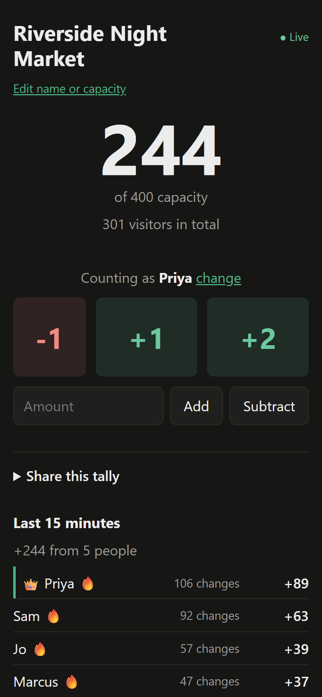
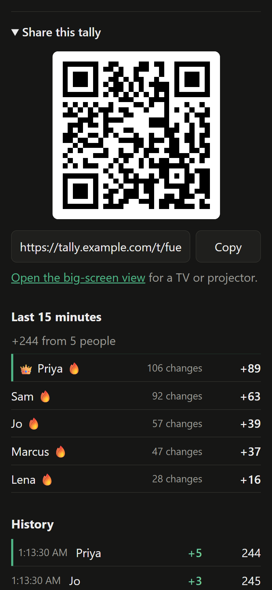
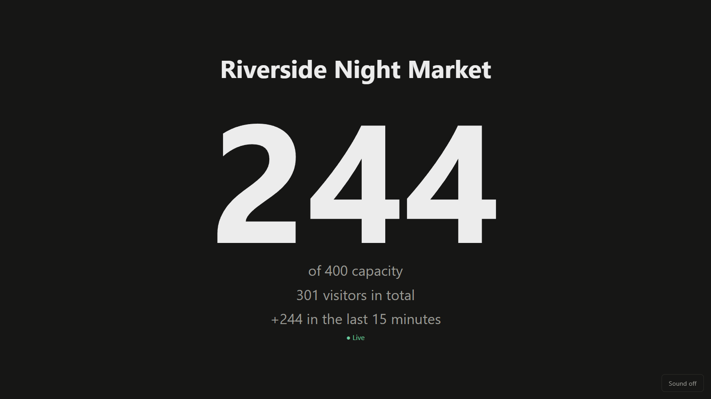

# FreeTally

Count people through the doors as a team. Start a tally, put its QR code on the door, and everyone counts from their own phone into one live total.

<p>
  
  
</p>

The big-screen view, for a TV or projector at the door:



- **No app, no accounts.** Scan the code, pick a name, start tapping.
- **Made for a busy door.** About 50 phones can count at once, and each sees the others' taps within a fraction of a second.
- **Copes with bad signal.** Taps made offline wait on the phone and go through once when it reconnects.
- **Knows when you're full.** Set a capacity and the count turns amber at 90% and red at 100%.
- **Big screen at the door.** Show the live count on a TV or projector.
- **A record for afterwards.** Every tap is kept with who and when, and admin exports it to CSV.
- **Yours to run.** One small Go binary and a SQLite file. It idles at about 10 MB of memory, runs on a free VPS, and on Fly.io costs only the disk while nobody's using it.

## Features

- **Counting:** +1, +2 and -1 buttons, or type an amount to add or subtract. There's no reset; to get back to zero, subtract the exact amount.
- **Names:** each phone picks a name once. A hidden per-browser device ID keeps two people with the same name apart, and the page warns when a name is already taken.
- **Undo:** for 10 seconds after a tap, you can undo it. This adds a correcting entry, so history stays complete.
- **Patchy signal:** taps made offline wait on the phone, survive a reload, and are sent exactly once when the connection returns.
- **Capacity:** optional. The total turns amber at 90% and red at 100%.
- **Visitors:** alongside the number inside now, each tally keeps how many people have come in altogether. Arrivals add to it, people leaving don't, and undoing an arrival takes it back off. Tallies from before this were worked out from their history. It shows under the total, on the big screen, in admin and in the CSV export.
- **Editing:** the browser that started a tally can change its name and capacity later. Creating a tally returns a secret owner key that only that browser keeps; the server stores only its hash. If the owner loses that browser, admin can make a new owner link (`/t/<id>#owner=<key>`), which replaces the old key. Opening it saves the key in that browser and removes it from the address bar.
- **Big-screen view:** `/t/<id>/screen` shows the name and total for a TV or projector, with rolling digits and optional sound.
- **Celebrations:** the total pops on each change, taps float a "+1" from the button, and confetti marks every 100 and reaching capacity. The 15-minute list crowns the clear leader and flags anyone with 10 or more changes in the last minute. All motion stops when the device asks for reduced motion.
- **Batched updates:** your own taps show at once. Everyone else's arrive together when 20 are waiting, or 100ms after the first, whichever comes first. From 90% of capacity, every change goes out immediately, because that's when a stale count could let someone in over the limit.
- **Phones stay awake** while counting or showing the big screen.
- **Admin:** `/admin/<ADMIN_KEY>` lists every tally and can close, reopen, make a new owner link, export to CSV, download its log or delete each one. Closed tallies stay visible but read-only.
- **Rate limits,** set well above real use. Venue phones usually share one public IP, so counting is limited per phone (10 a second, bursts of 20) and per tally (200 a second), never per IP. Creating tallies is limited to 30 a minute per address, and each tally accepts up to 500 open pages, each address 500 across all tallies, and the server 2000 in all. A phone that hits a limit keeps its taps and sends them a moment later.
- **Hidden from search engines:** `robots.txt` disallows everything, and every response sends `X-Robots-Tag: noindex`.
- **Logging:** startup, shutdown and errors, admin actions (edit, close, reopen, new owner link, delete), and one `activity` line a minute when anything happened: taps, new tallies, open pages, rate-limited requests, dropped or turned-away pages, server errors and memory. Each page opening and closing (and why it closed) and each minute's refused taps are logged against their tally. Every line also goes into the database and is kept 180 days, so a tally's log can be downloaded from admin after the event. No names or addresses are logged.

## Running it

Local development needs Go 1.27 and Node 22.13 or later. Node is only for the dev and test scripts, and there's nothing to install:

```
pnpm dev     # serves pages from public/ (edits show on reload), restarts on .go changes, data in ./data
pnpm test    # builds the server, runs the API tests against it on a throwaway database
```

With Docker:

```
docker compose up -d --build
```

| Setting | Default | What it does |
| --- | --- | --- |
| `PORT` | `3000` | Port the server listens on. |
| `DATA_DIR` | `./data` (`/data` in Docker) | Where the SQLite database lives. |
| `PUBLIC_URL` | the request's host | Address used in share links and QR codes, e.g. `https://tally.example.com`. |
| `ADMIN_KEY` | off | Turns on the admin view. At least 32 letters, digits, `-` or `_`. |
| `CLIENT_IP_HEADER` | off | Behind a proxy, the header it puts the visitor's address in: `Fly-Client-IP` on Fly, `X-Forwarded-For` behind Caddy or nginx, `CF-Connecting-IP` behind Cloudflare. Set it only if every request comes through that proxy; see [Security](#security). |
| `STATIC_DIR` | off | Serves pages from this folder instead of the copy built into the binary. For development. |
| `BATCH_QUIET_MS`, `BATCH_MAX_WAIT_MS` | `100`, `100` | Batching timings. The tests set their own. |
| `IDLE_EXIT_MS` | off | Exits cleanly after this long with no requests (health checks aside) and no open pages. |

## How it fits together

- The backend is Go with two dependencies: `modernc.org/sqlite` (pure Go, so no C compiler in the build) and `rsc.io/qr`. The pages are built into the binary and gzipped once at startup; tally pages are filled in per request. The Docker image holds only the binary, about 17 MB, and uses about 10 MB of memory idle.
- `main.go` reads the settings and starts the server, `store.go` is the database, `api.go` the requests, `hub.go` the live updates, `limits.go` the rate limits, `static.go` the pages, `text.go` input cleaning and CSV, `qr.go` the QR codes, `stats.go` the activity log, and `log.go` the copy of the log kept in the database.
- A tally page arrives with the tally's snapshot (the latest 1000 changes) in it, and draws it before the first paint, so nothing moves as it loads. It then listens on `/events?v=2`. When the browser reconnects it sends the last change it saw (`Last-Event-ID`), and gets only what it missed. If it missed more than 1000, it's told to load the snapshot again from `/api/tallies/<id>/snapshot`.
- Each batch is encoded once and the same bytes go to every page. A page whose queue fills up has stopped reading (a phone asleep with the page open), so it's dropped; it catches up when it wakes.
- Every change stores the running total. Writes go through one lock, so two taps can't interleave and miscount.
- Each tap carries a random operation ID, so retries are recorded once.
- Pages see only the first 8 characters of each device ID, enough to tell a tally's phones apart. The full ID stays on the server, where it decides who can undo a change.
- The front end is plain HTML, CSS and JavaScript in `public/`, with no build step. `live.js` holds the connection and summary logic shared by the tally page and the big-screen view; `fx.js` holds the effects and sound.

## Updating without breaking live tallies

Tallies live in the data volume, so replacing the machine keeps them. Open phones reconnect by themselves, and taps made during the swap are sent afterwards. Two rules keep that true:

1. **Schema changes add, never alter.** New columns go in the list in `store.go`'s `migrate()`, which upgrades an existing database on startup. The tests start from a first-release database every run.
2. **The API stays backwards compatible.** Phones keep running the old page until they reload, so new request fields must be optional. For example, `device` and `undoes` are optional because pages from before them don't send them, and pages that don't ask for `v=2` still get a snapshot and then each change as it happens. Tallies created before owner keys existed can't be edited until admin makes them an owner link.

## Deployment

Any host works if it gives you three things: **one instance** (live updates and the write lock are in memory, so a second copy would split the tally), **a persistent disk** at `DATA_DIR` for the SQLite database, and **long-lived HTTP responses** for the live updates. Set `ADMIN_KEY` and `PUBLIC_URL`; the server reads `PORT` from the host if it sets one, and `/healthz` is the health check.

Back up by copying `DATA_DIR` while the server is stopped, or with `sqlite3 freetally.db ".backup copy.db"` while it runs.

### Fly.io

One machine with a 1 GB volume at `/data`. `fly.toml` has the settings but not the app name, so pass yours. With flyctl logged in:

```
fly deploy --ha=false -a <your-app>
```

`--ha=false` keeps it to one machine, as the volume can be attached to only one. `ADMIN_KEY` and `PUBLIC_URL` are Fly secrets (`fly secrets set ...`); `fly.toml` sets `CLIENT_IP_HEADER`.

The machine stops itself after an hour with nobody using it and nobody on a tally page (`IDLE_EXIT_MS`), which costs nothing while stopped apart from the volume. Fly's proxy starts it again on the next request, which takes a second or two. Fly's own auto-stop is off because it would stop the machine within minutes.

Fly snapshots the volume daily and keeps 5 days of snapshots (`fly volumes snapshots list`).

### A VPS (DigitalOcean droplet, Hetzner, Lightsail and the like)

The smallest size is plenty. Install Docker, clone the repo, and put the settings in a `.env` file next to `compose.yaml`:

```
PUBLIC_URL=https://tally.example.com
ADMIN_KEY=<at least 32 letters and digits>
CLIENT_IP_HEADER=X-Forwarded-For
```

In `compose.yaml`, change the port line to `"127.0.0.1:3000:3000"` so only the proxy can reach it (Docker's published ports skip the firewall), then `docker compose up -d --build`. Data lives in the `freetally-data` volume. To update, `git pull` and run the same command again.

For HTTPS, point the domain at the server and run [Caddy](https://caddyserver.com) with this `Caddyfile`; it gets and renews the certificate itself:

```
tally.example.com {
	reverse_proxy 127.0.0.1:3000
}
```

nginx works too, with `proxy_set_header X-Forwarded-For $proxy_add_x_forwarded_for;` so the server sees each visitor's address. The server sends `X-Accel-Buffering: no` on live updates and pings them every 25 seconds, so neither buffering nor the default timeouts get in the way.

#### Free VPS tiers

The server idles at about 10 MB of memory, so the free tiers are plenty. The image builds on Arm as well as x86. Free tiers change, so check the current terms:

- **Oracle Cloud Always Free:** Arm (Ampere A1) and small AMD VMs with block storage, with no time limit. Oracle may reclaim Always Free VMs that sit nearly idle for a week, which this one will between events; upgrading the account to pay-as-you-go stops that, and usage within the free limits stays free.
- **Google Cloud free tier:** one e2-micro VM with a 30 GB disk, in `us-west1`, `us-central1` or `us-east1` only. Outbound traffic past 1 GB a month is billed, and traffic to China and Australia isn't covered at all.
- **Azure and AWS:** credits or 12 months of a small VM for new accounts only, then normal prices.

### Render or Railway

Both build the `Dockerfile` straight from the repo. Attach a persistent disk (Render, paid instances only) or volume (Railway) at `/data`, keep it to one instance, set `ADMIN_KEY` and `PUBLIC_URL`, and use `/healthz` as the health check. Set `CLIENT_IP_HEADER` to the header the host's docs say carries the visitor's address. A disk means each deploy stops the old instance before starting the new one, so expect a few seconds' gap; phones queue their taps through it.

### Not Vercel, Netlify or other serverless hosts

Their functions have no persistent disk for SQLite, cut off responses after a time limit (which ends the live updates), and run as many short-lived copies that can't share the in-memory hub. It would need a different storage and real-time design; see below.

## Porting it

For hosts that can't run a Go container, port the server and keep the front end. `public/` only talks to the API, and `test/api.test.mjs` pins the API down and runs against any server:

```
BASE=https://your-port.example.com ADMIN_KEY=<key> node --test test/api.test.mjs
```

That makes a port a good job for a coding agent: give it this repo, name the target, and have it work until the tests pass. Expect to adapt the tests that depend on how this server does live updates (batching timings, the `/events` stream) and the one that upgrades a first-release database.

### PHP on shared hosting

Shared hosting runs PHP once per request and kills long requests, so the live updates have to change:

- Replace the `/events` stream with polling: the page asks for changes after the last one it saw every second or two. Switch `live.js` from `EventSource` to `fetch` on a timer; batching drops out.
- Use SQLite through PDO (or the host's MySQL). Record each tap in a `BEGIN IMMEDIATE` transaction so reading the last total and writing the next can't interleave, and keep the unique `(tally_id, op_id)` index so retries are recorded once.
- Keep rate limits in the database, since nothing survives between requests.
- Route `/t/<id>`, `/admin/<key>` and `/api/...` to one `index.php` with an `.htaccess` rewrite, and keep the database outside the web root.

### Cloudflare Workers and Durable Objects

This maps closely, and the free plan includes SQLite-backed Durable Objects within daily limits:

- One Durable Object per tally, found with `idFromName(tallyId)`. An object handles one request at a time, which replaces the write lock, and its built-in SQLite storage holds the tally's changes.
- Live updates over WebSockets using the hibernation API, so a tally with phones open but nobody tapping isn't billed for the time. The object broadcasts each batch to its sockets; `live.js` swaps `EventSource` for `WebSocket`.
- A Worker in front routes `/api/tallies/<id>/...` to the tally's object and serves `public/` as static assets.
- Admin needs a list of every tally: keep a small index in D1 or in one directory object, updated on create, close and delete.
- Per-phone and per-tally limits live in the tally's object; the per-IP limit on creating tallies can use the Workers rate limiting binding.

## Security

There are no accounts; links are the keys.

- **A tally link** (a random 10-character ID) lets anyone who has it count, subtract and watch. That's how sharing works, so share it only with the people counting.
- **Editing** needs the owner key (24 random bytes, stored only as a hash). **Admin** needs `ADMIN_KEY`, which can delete every tally, so treat the admin link as a password. Both are compared in constant time.
- **Input:** names are stripped of control and invisible characters and cut to length, every query is parameterised, pages set text rather than HTML, the snapshot embedded in a page can't close its script tag, and the CSV export defuses spreadsheet formulas. Requests are capped at 4 KB.
- **Browsers** get a content security policy that runs only the app's own scripts (the one inline script is allowed by its hash), and pages can't be framed or leak their address in `Referer`.
- **Addresses:** the per-address limits use the connection's address unless `CLIENT_IP_HEADER` names a header. Set it only when a proxy sets that header on every request and nothing can reach the server around the proxy; otherwise anyone could make up an address per request. The same setting makes the server believe `X-Forwarded-Proto` and `X-Forwarded-Host`. Set `PUBLIC_URL` in production so links never come from request headers.
- **Limits slow abuse; they don't stop it.** Anyone with a tally link can fill it with junk at up to 200 changes a second, and anyone with many addresses can create many tallies. Nothing caps disk use, so watch it on a public instance; admin can close or delete tallies.
- **HTTPS** is the proxy's job (Fly, Caddy and the others above do it).

## Licence

MIT. See [LICENSE](LICENSE).
